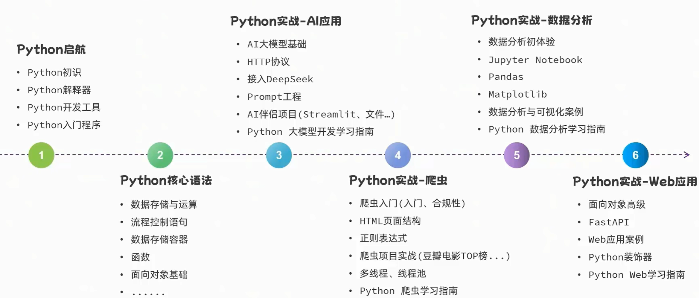

# 黑马python教程

**参考**

> - [python语法基础](https://www.bilibili.com/video/BV1sHU9BmEne/?cid=34278674060&spm_id_from=333.788.videopod.episodes&vd_source=bd4c7d99d71adf64d6e88c65370e0247&p=4)

## 入门

**python环境安装**

> - 下载：[python官网下载](https://www.python.org/downloads/windows/)
> - 安装：右键管理员安装，勾选add to path，选择customize自定义安装，勾选install for all users，安装到D盘

**PyCharm开发工具**

> - 下载：[官网下载](https://www.jetbrains.com/zh-cn/pycharm/download/?section=windows)
> - 安装：右键管理员安装，打开新项目时，右上角设置当前目录env,勾选 "Inherit global site-packages"（可选，能复用全局已装的包）

## 核心语法

**一、存储与运算**

1.字面量与变量

> - 字面量：写死的数据，即常量。
>   - 整数int,小数float：10，3.14
>   - 字符串str：'wo'
>   - 布尔值：True False。运算时自动转为1和0
>   - 空置：None
> - 变量：变量名=值。a=1

**二、逻辑处理**

**三、存储容器**

**四、函数**

**五、面向对象基础**

## AI应用

## 网络爬虫

## 数据分析

## Web应用
